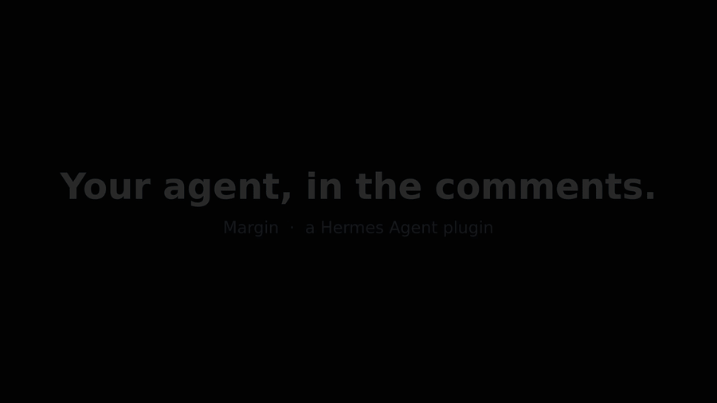

# Margin

**Comment `@hermes` on any highlighted text in Google Docs, Slides or Sheets, and Hermes answers right in the comment thread.**


<!-- GIF placeholder: record the 75-second demo in DEMO.md and save it as docs/demo.gif -->

Margin is a [Hermes Agent](https://github.com/NousResearch/hermes-agent) gateway platform plugin. Every Google Drive comment thread becomes its own Hermes chat session: Hermes sees the whole document plus the text you highlighted, replies in the thread, remembers the thread when you follow up, and can put its suggested wording straight into the Doc when you reply `apply`.

## Setup (5 steps)

1. **Create a Google Cloud OAuth client.** In the [Google Cloud console](https://console.cloud.google.com/apis/credentials), create a project, configure the OAuth consent screen (External, testing mode, add your own Google account as a test user), then create an OAuth client ID of type **Desktop app**.
2. **Enable the APIs.** In the same project enable the **Google Drive API**, **Google Docs API** and **Google Slides API**.
3. **Install the plugin.**
   ```bash
   hermes plugins install OWNER/hermes-margin --enable
   ```
   Hermes asks for `MARGIN_GOOGLE_CLIENT_ID` and `MARGIN_GOOGLE_CLIENT_SECRET` (the Desktop client from step 1).
4. **Sign in to Google, once, from a terminal.**
   ```bash
   hermes auth add margin:google      # `hermes margin auth` prints these steps and checks the sign-in
   ```
   Hermes runs the browser sign-in, stores the token in your profile and refreshes it. Margin never sees it.
5. **Watch a document and start the gateway.**
   ```bash
   hermes margin watch https://docs.google.com/document/d/<id>/edit   # or /margin watch <url> in any Hermes chat
   hermes gateway
   ```
   Highlight text in the doc and comment `@hermes make this clearer`.

## How it works

```
Google Doc comment "@hermes …"  ──poll──▶  Margin adapter  ──MessageEvent──▶  Hermes gateway ▶ agent
            ▲                                                                       │
            └──────────── reply in the same thread (status reply edited in place) ◀─┘
```

- **Polling.** Every 10 s (`MARGIN_POLL_INTERVAL`) Margin calls Drive `comments.list` for each watched file, with `startModifiedTime` set to the newest change it has seen, and fields including `quotedFileContent`, `replies` and `modifiedTime`. On errors it backs off exponentially (429 and 5xx are retried with backoff and `Retry-After`; the poll loop doubles its interval up to 5 minutes).
- **Triggers.** A new, unresolved comment that mentions `@hermes` (`MARGIN_TRIGGER`) opens a thread. Any later reply in a thread Margin has joined continues it; no mention needed.
- **Sessions.** `chat_id` is the Drive file id and `thread_id` is the comment id, so each comment thread is one Hermes session (`…:margin:group:<file>:<comment>`), and follow-ups have the thread's memory.
- **Context.** The first turn of a thread carries your request, the highlighted text and the document text (exported as plain text; CSV for Sheets; capped at `MARGIN_MAX_DOC_CHARS`, default 60,000 characters). The document is marked as untrusted data, and Margin turns can never run gateway slash commands.
- **Status.** Margin posts "🪶 Margin is reading the doc…", edits it to "is thinking…", then edits the same reply into the final answer.
- **Apply.** When Hermes proposes new wording it uses a fenced `replace` block. Margin shows it as "Proposed replacement" and, when you reply `apply`, calls Docs `documents.batchUpdate` (or Slides `presentations.batchUpdate`) `replaceAllText` with `matchCase`, **only if the highlighted text occurs exactly once** in the file. Otherwise it replies explaining why nothing changed.
- **Dedupe and loops.** Every comment and reply id Margin has handled is stored, so restarts never replay a turn. Existing comments are recorded, not answered, when a file is first watched. Margin ignores replies it posted (by id, and by its `🪶 Margin` marker).
- **Who can trigger it.** By default only the signed-in Google account. Add other commenters with `MARGIN_ALLOWED_USERS` (Drive permission ids or emails, when Google exposes them), or `MARGIN_ALLOW_ALL_USERS=true` to let anyone who can comment on a watched file drive your agent (not recommended).

### Commands

| Command | What it does |
|---|---|
| `/margin watch <url or id>` · `hermes margin watch <url>` | Start watching a Doc, Slides deck or Sheet |
| `/margin unwatch <url or id>` · `hermes margin unwatch <url>` | Stop watching it |
| `/margin list` · `hermes margin list` | List watched files (including `MARGIN_WATCH_FILES`) |
| `/margin status` · `hermes margin status` | Last poll time or error per file, threads joined |
| `hermes margin auth` | Setup steps and the current Google sign-in |

### Configuration

| Variable | Default | |
|---|---|---|
| `MARGIN_GOOGLE_CLIENT_ID` / `MARGIN_GOOGLE_CLIENT_SECRET` | required | Your own Desktop OAuth client |
| `MARGIN_WATCH_FILES` | empty | Comma-separated URLs or ids, added to the watch list |
| `MARGIN_TRIGGER` | `@hermes` | Mention that opens a thread |
| `MARGIN_POLL_INTERVAL` | `10` | Seconds between polls (minimum 2) |
| `MARGIN_MAX_DOC_CHARS` | `60000` | Document characters sent with the first turn |
| `MARGIN_ALLOWED_USERS` / `MARGIN_ALLOW_ALL_USERS` | owner only | Who else may trigger Hermes |

## Privacy and disclosure

- **Your document goes to your model.** The full text of a watched file (up to `MARGIN_MAX_DOC_CHARS`), the highlighted text and the comment thread are sent to whichever model provider your Hermes profile uses, at the start of each thread. Don't watch files you aren't allowed to send there.
- **Network calls:** only Google APIs: `www.googleapis.com` (Drive), `docs.googleapis.com`, `slides.googleapis.com`, every 10 s per watched file while the gateway runs. Requests are made through Hermes's `credentialed_provider_request`, which attaches the token only for those declared hosts.
- **Credentials:** Margin declares an `oauth:` client in `plugin.yaml`. Hermes runs the sign-in (`hermes auth add margin:google`), stores the grant in your profile's auth store and refreshes it. Margin never reads, stores or refreshes a token. Scopes: `drive` (read files and comments, post and edit replies), `documents` and `presentations` (apply). Revoke with `hermes auth logout margin:google`.
- **Writes to your files:** Margin posts and edits its own comment replies, and changes document text only when someone allowed replies `apply` in a thread.
- **Stored data:** the watch list, poll cursors, handled comment/reply ids, and per-thread highlighted text and last proposal, in Hermes's per-plugin state under `<HERMES_HOME>/plugin-data/`. No document text, no credentials.
- **Background work:** a polling loop inside the Hermes gateway process. No shell commands, no subprocesses, no telemetry, no self-update.

## Limitations

- Polling, not push: replies appear within one poll interval (about 10 s) plus model time.
- Comment replies are plain text; Markdown is flattened.
- `apply` works in Docs and Slides only, for a single-paragraph highlight that appears exactly once. Sheets threads get answers but no `apply`.
- When Margin signs in as your own Google account, its replies appear under your name, marked `🪶 Margin`. Use a separate Google account shared on the doc if you want a distinct author (then add your own account to `MARGIN_ALLOWED_USERS`).
- Google may show an "unverified app" screen for a personal OAuth client in testing mode, and testing-mode refresh tokens expire after 7 days (sign in again with `hermes auth add margin:google`).
- Very large documents are truncated to `MARGIN_MAX_DOC_CHARS` in the first turn. Edits made to the document after a thread starts are not re-sent automatically.
- Comments anchored to images, drawings or Sheets ranges may arrive without highlighted text.

## Development

```bash
pip install pytest pytest-asyncio     # inside a Hermes venv (Python 3.14)
pytest                                 # fake Google transport; no credentials needed
hermes plugins validate .
```

## License

MIT © Tinkerer (Pratik Poddar)
